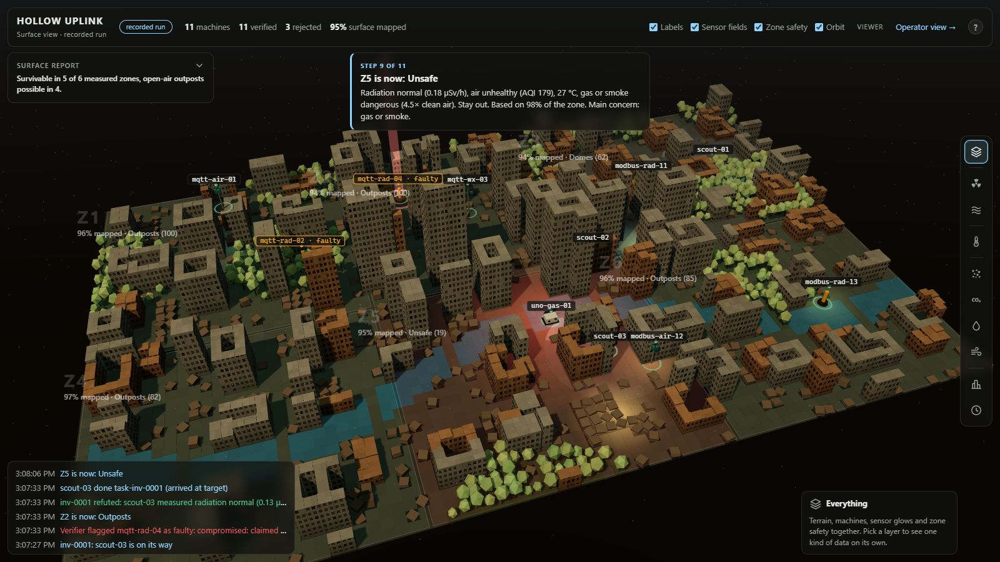
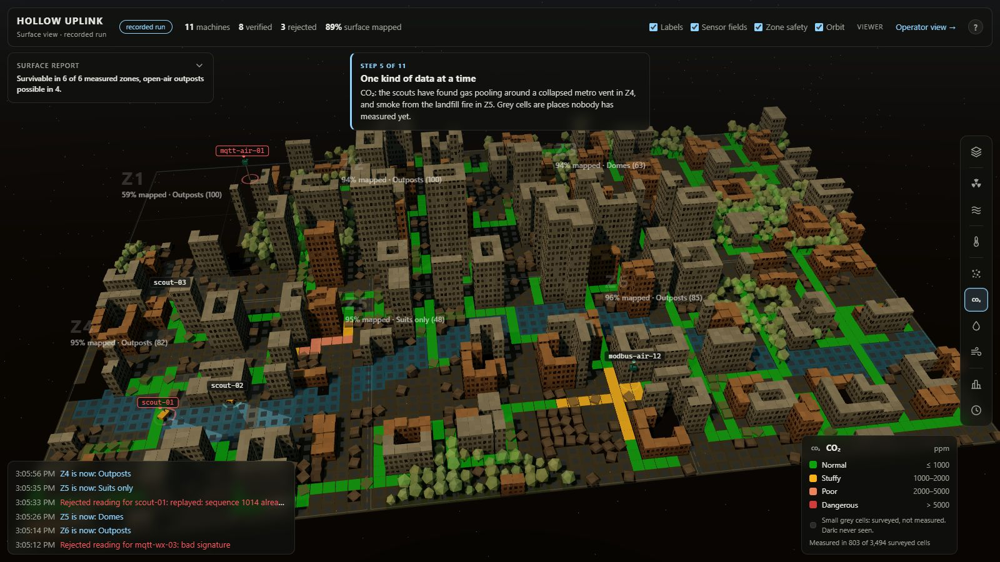
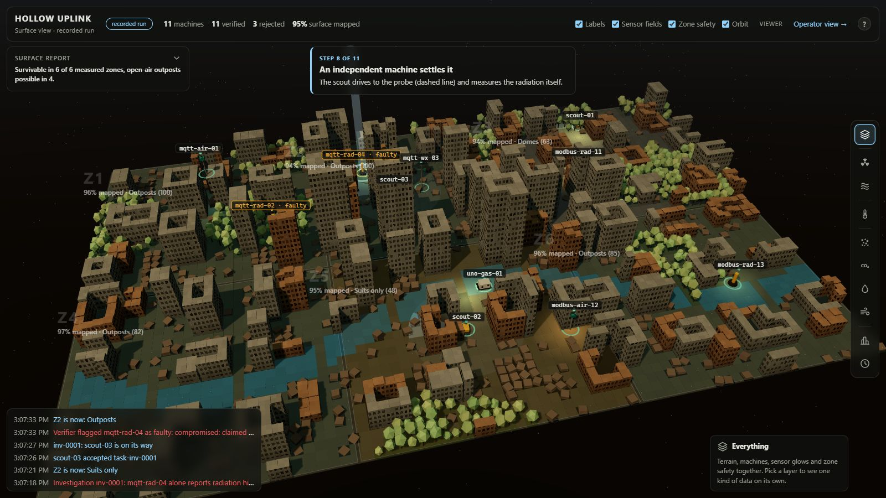

# Hollow Uplink

*The machines kept us out. Now they're building our way home.*

Patriot HackFest Fall 2026, Life Underground track (problems #13, #14, #15, and #7).



**The problem.** For thirty years the Directorate has told the Hollow that the surface air kills in minutes. Nobody has gone up to check. Machines left on the surface are still running, but they're from dozens of vendors, they speak different protocols, and nobody knows which ones still tell the truth. Any one of them could be broken, or quietly made to lie.

**Hollow Uplink is a universal translator for those machines, and a referee for what they say.** It answers one question, "is it safe up there, and where?", in a way nobody has to take on faith:

- **It finds machines and learns their language.** Edge gateways discover machines over MQTT and Modbus TCP, work out what each one is from the shape of its data, and translate everything into one common format. One of them is a real Arduino sensor box on the table.
- **It signs every reading.** Each reading is signed (Ed25519) at the gateway. Forged, tampered and replayed messages are rejected on screen, and nothing on the map changes.
- **It catches the lie a signature can't.** A hijacked sensor can tell a believable, validly signed lie. When one unconfirmed machine is what changes a zone's verdict, the verifier doesn't believe it or bury it: it opens an investigation, and an operator sends another machine to measure the spot.
- **It gives residents an answer in plain words.** Each zone gets a verdict (open-air outposts, domes, suits only, or stay out), with a confidence and the reason. Broken sensors are left out, and so are spots nobody has measured.
- **Humans stay in charge.** Machines only move on operator-signed orders, and one kill switch halts everything that moves.

| One kind of data at a time | The lie a signature can't catch |
| --- | --- |
|  |  |
| Map layers show radiation, air quality, CO₂ and more, each cell from a trusted machine's latest measurement. | A hijacked probe reports 8 µSv/h, validly signed. A scout the operator sends measures 0.13 there; the claim is refuted and the probe flagged. |

**See it.** Watch the recorded demo online at https://hollowup.link (every machine simulated, nothing to install). Or run `python run.py --demo` for the live system with the scripted story (about five minutes with `--auto`), or play the recorded run, which needs no broker. Details under [Run it locally](#run-it-locally-windows-powershell-on-macoslinux-use-venvbinpython).

**World assumption:** the machines were built by humans of our era and later, so they speak real protocols (MQTT, Modbus, ROS). The protocols, discovery, translation, signing and dashboard are real code; the machines are simulated, except the Arduino field station (`hardware/`).

The data contract (message formats and topics) lives in the project outline doc. Change it only by team agreement.

## How it fits together

```
MQTT machines ───publish──▶ edge gateway ──signed readings──▶ broker ──▶ verifier, dashboards
Modbus devices ◀──scan+poll──  discover, fingerprint,                     (check every signature)
 (per site)                    translate, sign
```

**Protocols.** Two real protocols today, each with a different discovery problem:

| Protocol | How the gateway finds a machine | How it learns what it is | Translation work |
| --- | --- | --- | --- |
| MQTT | Machine publishes on the site's raw topics | Shape of its JSON (which keys it has) | Field names, nesting, °F to °C, units |
| Modbus TCP | Gateway scans the site's local addresses (private and loopback only, at most 256) | Read Device Identification (function 43/14): vendor and product code | Raw 16-bit registers: scaling, signed values, 32-bit values across two registers, a vendor that stores them word-swapped |

ROS 2 (via rosbridge) is planned; adding it is one new adapter in `gateway/adapters/`.

Each teammate runs one edge gateway for their "site". It reads only its own site's raw topics (`surface/raw/<gateway_id>/...`), so the demo really runs across several states over one cloud broker.

| Path | What it is |
| --- | --- |
| `hollow/` | Shared code: config, MQTT client, topic names, Ed25519 signed envelopes |
| `gateway/` | Edge gateway and protocol adapters (`gateway/adapters/`; a new protocol = one new adapter). `modbus_adapter.py` holds the register maps and the scanner |
| `simulators/` | Fake MQTT machines in their own vendor formats (`--faulty` units), real Modbus TCP servers acting as two vendors' field devices (`modbus_device.py`), scout robots that map the surface with simulated LiDAR, and `world.py`, the hidden "true" city only simulators can see |
| `dashboard/city.html` | 3D surface view (Three.js). Starts dark; every tile comes from a verified scout survey and fades as its scan ages |
| `dashboard/index.html` | Operator view: flat map, machine table, event feed |
| `dashboard/uplink.js` | Shared live-data client: MQTT plus signature checks, used by both views |
| `dashboard/layers.js` | Map layers shared by both views: the layer list, their colours and legends, and the per-cell measurement store |
| `verifier/` | Flags faulty sensors, scores each zone (outposts / domes / suits / not safe / unknown) with a confidence and a plain-language verdict, and publishes a signed map snapshot for late viewers. Thresholds in `verifier/scoring.py` |
| `tools/keygen.py` | Makes a gateway key and adds its public key to `keys/trusted.json` |
| `tools/spoof.py` | Sends forged or tampered readings to show they get rejected |
| `tools/operator.py` | Operator actions from the command line (approve a task, kill switch, switch a relay), signed with the operator key |
| `hardware/` | The one real machine: an Arduino Uno field station (gas, climate, hatch, relay). Wiring, setup and demo script in `hardware/README.md` |
| `tools/uno_bridge.py` | Forwards the Uno's USB serial lines to the site's MQTT network and commands back (`--fake` without a board) |
| `tools/attack.py` | Simulation only: makes a running sensor tell a believable, validly signed lie |
| `tools/demo.py` | The scripted demo: runs the story step by step, with captions in the 3D view |
| `tools/build_public.py` | Builds `public/`, the public demo: a static site playing a run where every machine (the Uno too) is simulated, signed with throwaway keys, with no broker |
| `tools/record.py` | Records everything the dashboards receive, for replay with no broker (`dashboard/recordings/`) |
| `run.py` | Starts the whole local stack with one command (and the demo, and a recording) |
| `tests/` | Unit and end-to-end tests: `python -m unittest` |
| `dev/broker.py` | Local MQTT broker with no Docker (`docker compose up` works too) |

## Run it locally (Windows PowerShell; on macOS/Linux use `.venv/bin/python`)

One-time setup:

```
python -m venv .venv
.\.venv\Scripts\python -m pip install -r requirements-dev.txt
.\.venv\Scripts\python -m tools.keygen gw-local
.\.venv\Scripts\python -m tools.keygen verifier
.\.venv\Scripts\python -m tools.keygen operator
```

The operator key approves tasks and controls the kill switch. Keep `keys/operator.key` private; it is git-ignored and the dev server refuses to serve `.key` files.

Then start everything with one command:

```
.\.venv\Scripts\python run.py
```

It starts the broker, the Modbus devices, the gateway, the verifier, the sensors, three scouts and the web server in the right order, opens the 3D view, and stops them all on Ctrl+C. Each service's output is in `logs/<name>.log`. Missing keys are created on the first run. Options: `--scouts 2`, `--tick 0.5`, `--no-browser`, and `--uno COM3` to bring in the real Arduino field station (`--uno fake` imitates one; see `hardware/README.md`). `--demo` and `--record` are below.

Or run each piece in its own terminal (what `run.py` does for you):

```
.\.venv\Scripts\python dev\broker.py
.\.venv\Scripts\python -m simulators.modbus_device
.\.venv\Scripts\python -m gateway.gateway --gateway gw-local
.\.venv\Scripts\python -m verifier.verifier
.\.venv\Scripts\python -m simulators.mqtt_sensor --gateway gw-local --faulty mqtt-rad-02
.\.venv\Scripts\python -m simulators.scout --gateway gw-local --scouts 3 --tick 0.3
.\.venv\Scripts\python dev\serve.py
```

The Modbus devices listen on 127.0.0.1:5020-5022, each one standing in for a separate box on the site network. The gateway scans the addresses in `gateway/config.json` (`modbus.scan`), asks each device who it is, and re-scans every 30 s, so a device started later still gets found.

`dev/serve.py` is a static server with caching turned off, so a normal reload picks up dashboard edits.

Open http://localhost:8000/dashboard/city.html. The **Surface report** on the left is the resident's answer: the Directorate's claim, then a plain-language verdict per zone from the verifier. Within seconds the verifier flags `mqtt-rad-02` as faulty (pinned at its maximum, stuck, and contradicted by nearby scouts) and leaves it out. The surface starts dark; the scouts reveal it as they explore (about 40% mapped after a minute, 95% after five). Hover a tile to see when and by whom it was scanned, and click a machine for its readings and signature status. The operator view is at http://localhost:8000/dashboard/.

**Map layers.** The strip on the right of the 3D view (and beside the operator view's map) shows one kind of data at a time: radiation, air quality, temperature, PM2.5, CO₂, humidity, wind, terrain, or how old each scan is. Scouts carry a full environmental pack, so every layer fills in as they explore. Look for CO₂ pooling around a collapsed metro vent in Z4, smoke and dust around the landfill fire in Z5, damp air along the river, and the old downtown sheltered from the wind. Data layers keep the whole city standing (buildings solid, rubble and trees slightly see-through) with a slightly see-through coloured map on the ground, where each 5 m cell is coloured by the latest value a trusted machine measured there; cells nobody measured stay small and grey, and only the machines that measure that quantity are shown. Hover a cell for the value, who measured it and when. Readings from machines the verifier has flagged are never painted. The verifier includes these per-cell measurements in its signed map snapshot (`measures`), so a page opened late sees everything measured so far.

**Scripted demo.** `run.py --demo` also runs `tools/demo.py`, which walks through the story step by step and shows a caption for each one in the 3D view:

1. The dark city being mapped
2. A broken sensor being left out
3. Forged and tampered messages being rejected
4. A replayed message being rejected
5. The radiation and CO₂ layers
6. A hijacked probe telling a believable lie
7. The verifier opening an investigation
8. A scout settling it
9. The real Arduino field station: smoke in the box turns Z5 unsafe, a forged relay command is rejected, then the operator switches the relay on (only when the board, or `--uno fake`, is reporting)
10. The kill switch, which also switches the relay off
11. The closing line

Press Enter for each step. While waiting for the system to react, Enter skips ahead. At the investigation step you can click **Approve** in the 3D view (in operator mode) or press Enter to approve it from the console. `--demo --auto` runs the whole thing by itself in about five minutes (`run.py --demo --auto --uno fake` includes the field station without the board). With the real board in step 9, blow out a match near the box when the console asks. To run the demo against a stack that's already running, use `python -m tools.demo`; add `--start 9` to rehearse from step 9.

The attacks are the same tools listed further down. One thing is staged, and it's simulation-only: while the hijacked probe is under investigation, untasked scouts keep out of a small circle around it. That way the scout the operator sends is the one that settles it, not one that happens to drive past.

**Recorded run (no network needed).** `run.py --record` saves everything the dashboards receive to `dashboard/recordings/demo.jsonl.gz` (about 0.1 MB a minute). `run.py --demo --auto --record` records the full demo, captions included, and stops when it's done. Open http://localhost:8000/dashboard/city.html?replay=recordings/demo.jsonl.gz to play it back (add `&speed=2` for double speed). The operator view takes the same `?replay=`.

The recording keeps every signed envelope byte for byte, plus the public keys they were signed with, and the dashboards check every signature again on playback. If the live broker can't be reached, the page offers the recording after five seconds. Because a replay is only static files, the `dashboard/` and `keys/trusted.json` files plus a recording can be put on any static host (for example GitHub Pages) as a demo that always works.

**Public demo (for the open internet).** `python -m tools.build_public` builds `public/`, the version to put online. It records a fresh full scripted run (about five minutes) where every machine is simulated, including the Arduino field station (`--uno fake`). The run is signed with throwaway keys made for that build (`.public-demo/keys`, git-ignored), and the build refuses to finish if any signer matches `keys/trusted.json`. The site's `config.js` has no broker address, so the pages go straight to the recording, with no operator mode and nothing to connect to. None of our devices, brokers or keys are reachable from it. Upload `public/` to any static host. To try it locally, run `python -m http.server -d public 8080` and open http://localhost:8080/. `--reuse` rebuilds the site without recording again. Pushing a rebuilt `public/` to main publishes it at https://hollowup.link (`.github/workflows/pages.yml`; Pages source set to GitHub Actions).

The page still loads Three.js, mqtt.js and tweetnacl from public CDNs. Open it once while online so the browser caches them, or copy them into the repo, before relying on it with no internet at all.

**Why the map is honest:** the gateway and dashboard never read `simulators/world.py`. They only know what scouts report, in signed readings, so a forged survey is rejected like any forged reading.

Try the attacks:

```
.\.venv\Scripts\python -m tools.spoof forged mqtt-air-01 --zone Z1 --gateway gw-local
.\.venv\Scripts\python -m tools.spoof tampered mqtt-wx-03 --zone Z2 --gateway gw-local
```

Both show as rejected in the event feed: signatures catch altered or forged messages. A third attack records a genuine signed reading and re-sends the exact bytes:

```
.\.venv\Scripts\python -m tools.spoof replayed scout-01
```

The signature is valid, but the sequence number has already been seen, so it is rejected as replayed.

**Operator mode.** The 3D view opens read-only. Click **Unlock operator** and pick `keys/operator.key` to approve investigations, use **Sandbox** (tasks are acknowledged but never sent to machines) and the **Kill switch** (every robot halts and new tasks are refused, for everyone, until released). The same actions are scriptable:

```
.\.venv\Scripts\python -m tools.operator killswitch on
.\.venv\Scripts\python -m tools.operator killswitch off
```

**The lie signatures can't catch.** Once Z2 has a verdict (a couple of minutes of scouting), hijack its radiation probe:

```
.\.venv\Scripts\python -m tools.attack compromise mqtt-rad-04 --value 8
```

The probe now reports a believable 8 µSv/h, passed through the real gateway and validly signed. Z2's verdict drops. The verifier notices that one unconfirmed machine is changing the answer and opens an investigation. In the 3D view's Surface report, click **Approve: send scout-0X to check**. The scout drives there (dashed line), measures about 0.13 µSv/h, the verifier marks the claim **refuted**, flags the probe as compromised and Z2's verdict recovers. If the reading had been real, the investigation would say **confirmed** instead. Undo with `tools.attack restore mqtt-rad-04` (the verifier keeps treating a refuted machine as compromised until it restarts).

Any independent machine measuring the spot settles an investigation, so a scout that happens to drive past can resolve it before the one you sent arrives. For a clean recording, run a single scout (`--scouts 1`) or attack a sensor the scouts are far from. The verifier also opens investigations on its own for real hazards only one machine has seen (for example the smoke in Z5); those end **confirmed**.

## Tests

```
.\.venv\Scripts\python -m unittest
```

About 100 tests, a second or two, with no broker, keys or network needed (they use throwaway keys and never touch `keys/`). They cover:

- **Signing and replay protection:** tampering, impersonation and roles
- **Every vendor format:** generated by the simulators and the Uno bridge's stand-in board, so a format change on one side fails here
- **Gateway:** discovery, signed readings, and which commands ever reach a machine (forged, unapproved, replayed, kill switch)
- **Verifier:** faulty-sensor detection, zone scores and investigations, including the hijacked-probe story
- **Simulated world and scout keep-away**
- **The committed demo recording**

Run one file with `python -m unittest tests.test_verifier`. pytest also runs them if you prefer it.

## Joining the shared cloud broker (each teammate)

1. Copy `.env.example` to `.env` and fill in the HiveMQ Cloud host and credentials (`MQTT_PORT=8883`, `MQTT_TLS=1`) and your own `GATEWAY_ID`, e.g. `gw-va`.
2. `python -m tools.keygen gw-va`, then commit `keys/trusted.json`. Never commit `keys/*.key`.
3. Copy `gateway/config.example.json` to `gateway/config.json` and place your units on the map.
4. Run your gateway and simulator. Use unique unit ids across the team (e.g. `mqtt-air-11`).

The dashboard's `config.js` is public once hosted, so give it its own broker user, not the gateways' credentials.

## What's not built yet

- ROS 2 adapter (planned, via rosbridge; needs Docker for the ROS side)
- Modbus devices are read-only sensors; writing registers (e.g. switching a vent) isn't supported yet
- Zone goals ("make Z4 outpost-ready") with a planner that turns them into tasks for approval
- Readings are signed at the gateway, not by the device, so a compromised gateway could still lie; investigations are the defence there
- The local dev broker (amqtt) also delivers unrelated retained messages on subscribe; use Mosquitto or HiveMQ for anything real
- Structural sensors (tilt and vibration) to flag unstable buildings
- Discovery events aren't retained, so a dashboard opened later learns about machines from their readings instead
- The verifier keeps its map in memory; restarting it starts the map over
